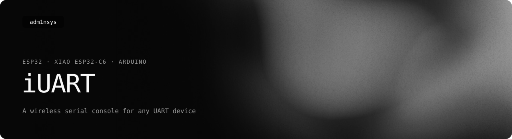
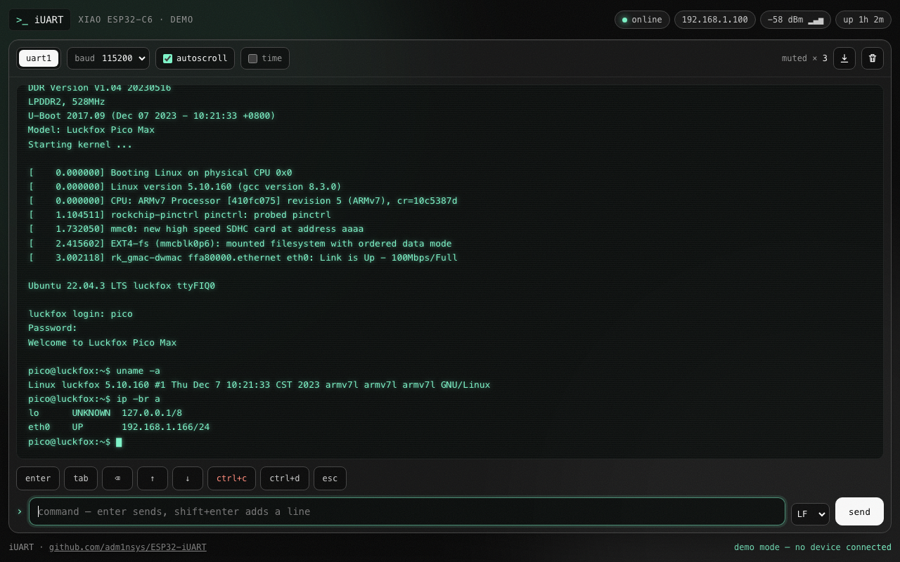

<picture>
  <source media="(prefers-color-scheme: light)" srcset=".github/readme/banner-light.svg">
  
</picture>

<p>
  <a href="https://adm1nsys.github.io/ESP32-iUART/"></a>
  <a href="https://github.com/adm1nsys/ESP32-iUART/releases/latest/download/iuart-esp32-wroom-32.bin"></a>
  <a href="https://github.com/adm1nsys/ESP32-iUART/releases/latest/download/iuart-xiao-esp32c6.bin"></a>
  <a href="https://adm1nsys.github.io/ESP32-iUART/web/"></a>
  <a href="https://adm1nsys.github.io/ESP32-iUART/#versions"></a>
  <a href="https://github.com/adm1nsys/ESP32-iUART/actions/workflows/build.yml"></a>
  <a href="LICENSE"></a>
</p>

**A wireless serial console.** Wire an ESP32 to the UART of any device — an Arduino, a Linux board, a router, another microcontroller — and read and type into its console from a browser on your phone or computer. No USB-UART adapter, no cable to the desk.



## Features

- **Live console** in the browser — colors and control sequences cleaned up, autoscroll, timestamps, save the log as a file.
- **Typing like a terminal** — Enter, Tab, Backspace, ↑ / ↓ (shell history on the device), Ctrl+C, Ctrl+D, Esc; LF, CRLF, CR or no line ending; your own command history in the input.
- **Two ports on ESP32** (UART1 / UART2), one on XIAO ESP32-C6; baud rate from 9600 to 1.5 M, switchable live.
- **Muted lines** — messages a device repeats endlessly are counted instead of flooding the screen (configurable).
- **Works anywhere** — joins your Wi-Fi (DHCP or a fixed address), and if none is in reach opens its own access point. Reachable as `http://iuart.local`.
- **Self-contained** — the page is gzipped into the firmware and needs no internet: no fonts, libraries or CDNs.

## Wiring

Cross the data lines and share ground. Use 3.3 V logic only — for 5 V devices (classic Arduino Uno, etc.) put a level shifter or at least a divider on the line into the ESP32.

| | ESP32 WROOM-32 | XIAO ESP32-C6 | Your device |
|---|---|---|---|
| UART1 RX | GPIO 16 | D7 (GPIO 17) | ← TX |
| UART1 TX | GPIO 17 | D6 (GPIO 16) | → RX |
| UART2 RX | GPIO 25 | — | ← TX |
| UART2 TX | GPIO 26 | — | → RX |
| GND | GND | GND | GND |

Disconnect the device's TX line while flashing the ESP32 if the upload fails.

## Install

**Ready-made firmware** — download `iuart-esp32-wroom-32.bin` or `iuart-xiao-esp32c6.bin` from the [releases](https://github.com/adm1nsys/ESP32-iUART/releases) and flash it at address `0x0`, for example in the browser with [ESP Web Tools](https://espressif.github.io/esptool-js/) or with `esptool.py write_flash 0x0 iuart-….bin`. It starts as the access point **iUART** (password `iuart-console`); open `http://192.168.4.1`.

**Your own Wi-Fi** — build it yourself:

1. Copy `iUART/config.example.h` to `iUART/config.h` and add your networks (it is ignored by git, so passwords never get committed).
2. Open `iUART/iUART.ino` in the Arduino IDE with the ESP32 core (Espressif, 3.x) and upload — or with arduino-cli:

   ```bash
   arduino-cli compile --upload --fqbn esp32:esp32:XIAO_ESP32C6 --port /dev/cu.usbmodem1101 iUART
   ```

3. The serial monitor (115200) prints the address, e.g. `Connected: http://192.168.1.100`.

## Development

| Path | What it is |
|---|---|
| [`iUART/iUART.ino`](iUART/iUART.ino) | firmware: Wi-Fi, HTTP API, ring buffer for the serial output |
| [`iUART/config.example.h`](iUART/config.example.h) | networks, access point, baud rate, muted lines |
| [`web/`](web) | the interface — open `web/index.html` directly to work on it in demo mode |
| [`tools/embed_web.py`](tools/embed_web.py) | packs `web/` into `iUART/web_ui.h` (gzip) — run it after changing the page |

The page talks to the board over a small API: `GET /api/status`, `GET /api/logs?since=N`, `POST /api/send`, `POST /api/uart`, `POST /api/baud`, `POST /api/clear`.

[CI](.github/workflows/build.yml) checks that `web_ui.h` matches `web/`, builds the firmware for both boards and attaches it to every release.

## History

Built in 2024 to debug a Luckfox Pico Max without a USB-UART adapter at hand — hence the muted `udhcpc` line in the default config. Since then it is a general tool for any UART device; in 2026 it got a new interface, XIAO ESP32-C6 support, the access point fallback and ready-made firmware.

---

Heorhii Romanenko · [adm1nsys.github.io](https://adm1nsys.github.io/adm1nsys/) · GPL-3.0
